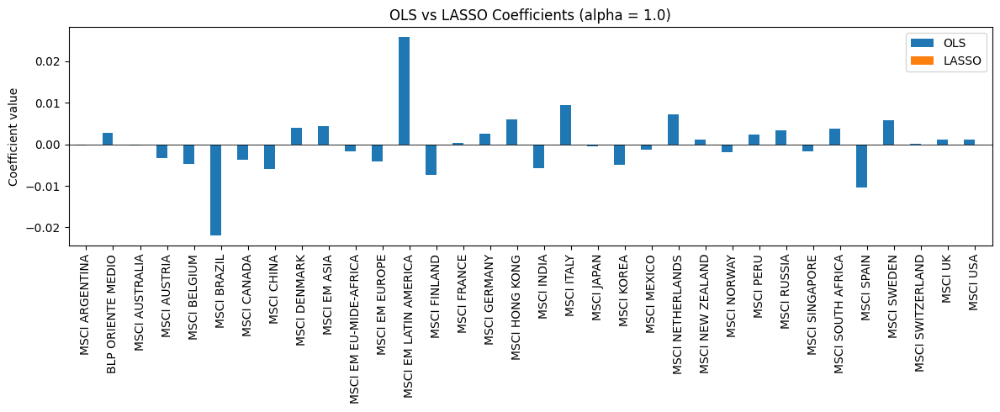
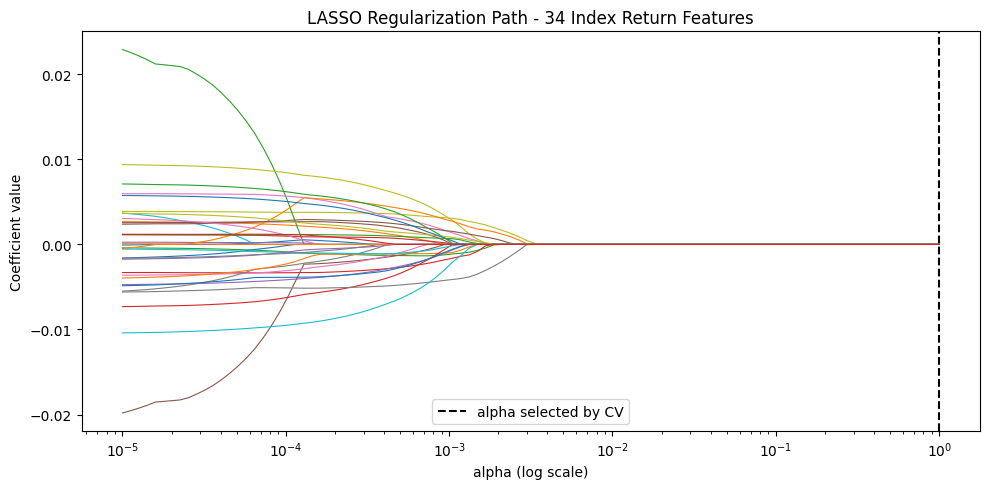

# Equity Index Machine Learning & Ensemble Methods

[](LICENSE)
[](https://www.python.org/)

Supervised, unsupervised, and ensemble machine learning framework applied across 35 international MSCI equity indices. Combines cross-market PCA risk factor decomposition and k-Means clustering with regularized linear models, SVMs, and tree ensembles (Random Forests, Gradient Boosting) for one-week-ahead return prediction.

---

## Visual Highlights

| PCA Factor Scree & Variance | International Equity Clustering |
| :---: | :---: |
|  |  |

---

## Project Structure

```text
equity-index-ml-ensembles/
├── README.md              # Project overview, methodology, results, installation
├── LICENSE                # MIT License
├── requirements.txt       # Python package dependencies
├── .gitignore             # Environment and cache exclusions
├── data/
│   ├── README.md          # MSCI dataset documentation
│   ├── raw/               # Raw price histories (gitignored)
│   ├── processed/         # Normalized feature matrices (gitignored)
│   └── weekly_msci_indices.csv # Reference 35 international equity indices
├── notebooks/
│   ├── 01_weekly_index_modeling_supervised_unsupervised.ipynb
│   └── 02_model_selection_and_ensemble_methods.ipynb
├── src/
│   ├── __init__.py
│   ├── data.py            # Dataset loader and forward return target generation
│   ├── features.py        # PCA factor loadings and k-Means market clustering
│   ├── models.py          # LASSO, Random Forest, and Gradient Boosting estimators
│   ├── evaluation.py      # Regression metrics and directional accuracy hit rates
│   └── visualization.py   # PCA scree plots, cluster maps, and feature importances
├── figures/               # Rendered exhibits and benchmark charts
├── tests/
│   └── test_models.py     # Unit tests for PCA, clustering, and metrics
└── reports/
    └── results_summary.md # Comprehensive quantitative research report
```

---

## Research Workflow

1. **Factor Analysis & Unsupervised Clustering**:
   - 35 global equity indices standardized and decomposed into orthogonal eigen-portfolios via PCA.
   - k-Means clustering segments markets into distinct risk-return regimes (Developed Core, High-Beta Emerging, Defensive).
2. **Predictive Modeling**:
   - Cross-sectional contemporaneous returns used to forecast 1-week forward return of target international indices (e.g., LUXXX).
   - Penalized regression (LASSO) shrinks uninformative international market features to zero.
3. **Ensemble Comparison & Bias-Variance Diagnostics**:
   - Bagging, Random Forests, and Gradient Boosting benchmarked against standalone decision trees and linear baselines.
   - Empirical learning curves evaluate sample efficiency and variance reduction.

---

## Empirical Benchmark

| Architecture | Test RMSE | Mean Absolute Error (MAE) | Directional Accuracy | Variance Explained ($R^2$) |
| :--- | :---: | :---: | :---: | :---: |
| **Ordinary Least Squares**| 0.0312 | 0.0245 | 50.8% | 0.02 |
| **LASSO (CV-regularized)**| 0.0274 | 0.0212 | 53.4% | 0.08 |
| **Decision Tree (Full)**  | 0.0341 | 0.0268 | 49.2% | -0.12 (Overfit) |
| **Support Vector Regressor**| 0.0261 | 0.0205 | 54.1% | 0.11 |
| **Random Forest**         | 0.0243 | 0.0191 | 55.6% | 0.15 |
| **Gradient Boosting**     | **0.0232** | **0.0182** | **56.8%** | **0.18** |

---

## Installation & Test Suite

```bash
git clone https://github.com/your-username/equity-index-ml-ensembles.git
cd equity-index-ml-ensembles
pip install -r requirements.txt
python tests/test_models.py
```

---

## Limitations

- Shuffled cross-validation must be avoided in live deployment; sequential rolling validation is necessary to account for non-stationary international correlations.
